<div align="center">

# 🌙 Tams — BornHere App

### *The world the moment you arrived*

Aplikasi web yang merekonstruksi dunia di hari kamu lahir — fase bulan, zodiak, lagu #1, cuaca, harga, dan headline. Dibuat 100% lokal tanpa server eksternal, tanpa tracking, tanpa pengumpulan data. Semua data pakai konten Indonesia: harga dalam Rupiah, lagu hits Indonesia, dan headline sejarah Indonesia.


**🌐 Live demo:** https://tams-bornhere-app.vercel.app

**Repo stats:** 25 commits · 8 source files · 57 unit tests · 12 screenshots · 0 external API calls · Vercel auto-deploy

</div>

---

## 📖 Tentang Projek

Gw bikin app ini karena gw penasaran — gimana sih dunia waktu gw lahir? Bulannya lagi fase apa, lagu apa yang lagi ngetop di Indonesia, berapa harga beras waktu itu, berita apa yang lagi ramai? Daripada cari satu-satu di google, mending bikin tools yang langsung rekonstruksi semuanya dalam satu halaman.

Tams - BornHere App itu kayak *time capsule* buat hari lahir kamu. Lo masukin tanggal, tempat, dan nama — appnya langsung ngitung dan nampilin:

- 🌙 **Fase bulan** di hari itu (astronomis, bukan tebakan) dengan SVG illustration + illumination %
- ♈ **Zodiak barat** + 🐐 **Zodiak cina** berdasarkan tanggal lahir
- 💎 **Birthstone** dan 🌸 **birth flower** bulan lahir lo
- 📅 **Hari apa** (Senin, Selasa, dll) dan **berapa hari** lo udah hidup
- 💓 **Heartbeats** — estimasi detak jantung sejak lahir (sekitar 53 miliar!)
- ⏰ **Live age counter** — tahun, hari, jam, menit, detik yang terus berjalan
- 🌤️ **Cuaca** estimasi berdasarkan musim dan lokasi (dengan precipitation, wind speed)
- 🌅 **Sunrise & sunset** waktu di hari itu
- 🎵 **Lagu hits Indonesia** di tahun lo lahir (Chrisye, Iwan Fals, Tulus, dll)
- 💲 **Harga barang** waktu itu vs sekarang dalam Rupiah (beras, mi instan, bensin, motor, dll)
- 📰 **Headline sejarah Indonesia** di tahun itu (Proklamasi, Reformasi, Tsunami Aceh, dll)
- 🌍 **Gambar bumi** dari NASA Blue Marble

Semua perhitungan dilakukan di browser. Ga ada data yang dikirim kemana-mana. Ga ada server, ga ada database, ga ada analytics. Lo bisa buka appnya, matiin internet, dan tetep jalan.

---

## ✨ Fitur Lengkap

### Halaman Utama (Home)
- Form input: nama, tanggal lahir, tempat lahir (12 kota Indonesia), waktu lahir (opsional)
- Certificate preview yang **live update** — lo ketik nama, langsung ke update di certificate
- Animated counter "1,583,097 birthdays rebuilt"
- Starfield canvas background (bintang berkelap-kelip)
- Section "Explore a day" dengan 3 contoh sejarah Indonesia: Proklamasi 1945, Reformasi 1998, Milenium baru 2000
- Footer dengan navigasi: Gift, Pricing, Refunds, Privacy, Terms, Contact

### Halaman Story (10 Step Carousel)
Appnya punya flow 10 step yang kayak wizard:

| Step | Konten |
|------|--------|
| 0 | "Whose day are we bringing back?" — pilih My own / Someone I love |
| 1 | Day basics: hari apa, berapa hari di bumi, berapa full moon sejak lahir |
| 2 | "Where did you spend your childhood?" — input kota |
| 3 | "If you could revisit one age?" — input angka |
| 4 | "Let's bring a little piece of that year back" — year reveal |
| 5 | "What would you love to rediscover first?" — pilih topik |
| 6 | "Imagine shopping in the year you were born" — basket harga then vs now |
| 7 | "Do you know what time you were born?" — input waktu (opsional) |
| 8 | "What should we call you?" — konfirmasi nama |
| 9 | Final reveal: 8 capsule section lengkap |

### Final Step — 8 Capsule Sections

Step terakhir punya 8 section yang scrollable, masing-masing dengan label, headline, dan styled data cards:

**1. 📜 Certificate of Arrival**
Certificate personalized dengan nama, tanggal, kota, fase bulan, zodiak, birthstone, dan birth flower.

**2. 🔢 Your Life · In Numbers**
- "You've been here for X days"
- Live age counter (ticking real-time: 23y 153d 06:05:54)
- 3 stat cards: Full Moons Since You Arrived, Days Alive, Heartbeats (±53 miliar at 72 bpm)

**3. 🌤️ The Air Around You**
Weather card dengan temperature, condition, precipitation (mm), wind speed (km/h), high/low temps.

**4. 🌙 The Sky Above You**
- SVG moon illustration dengan glow effect
- Data table: Day, Phase, Illumination %, Sunrise, Sunset

**5. 🎵 The Soundtrack**
- Lagu hits Indonesia di tahun lahir
- Play button + streaming links (Apple Music, Spotify, YouTube)

**6. 💲 The Receipt**
Harga barang dalam Rupiah — dulu vs sekarang (beras, mi instan, bensin, telur, rumah, motor, ongkos angkot, kopi)

**7. 📰 The Headlines**
Headline sejarah Indonesia di tahun itu.

**8. 🌍 The Earth**
NASA Blue Marble image.

### Data Engine (data.js)
Semua perhitungan dilakukan oleh `data.js` yang bisa jalan standalone:

- **Moon phase**: synodic month 29.53059 hari, reference new moon 2000-01-06
- **Zodiak barat**: 12 zodiak dengan range tanggal presisi
- **Zodiak cina**: 12 hewan berdasarkan tahun (Rat, Ox, Tiger, dll)
- **Birthstone**: 12 batu mulia (Garnet, Amethyst, Aquamarine, dll)
- **Birth flower**: 12 bunga (Carnation, Violet, Daffodil, dll)
- **Days on Earth**: hitung selisih hari dari tanggal lahir ke sekarang
- **Full moons since**: hitung siklus bulan dari lahir sampai sekarang
- **Heartbeats**: days × 24 × 60 × 60 × 72 bpm
- **Sunrise/Sunset**: estimasi untuk region equatorial (Indonesia)
- **Precipitation**: berdasarkan kondisi cuaca
- **Wind speed**: deterministik dari tanggal (tanggal sama = wind sama)
- **Lagu hits Indonesia**: database per dekade dari 1970-2025 (Chrisye, Koes Plus, Iwan Fals, Nike Ardilla, Tulus, dll)
- **Harga IDR**: data harga historis per dekade (1970-2020) dengan comparison ke harga sekarang
- **Cuaca**: estimasi berdasarkan musim, **deterministik** (tanggal sama = cuaca sama)
- **Headline sejarah Indonesia**: peristiwa besar per dekade dari 1945-2025

---

## 🏗️ Arsitektur Projek

```
tams-bornhere-app/
├── index.html        # Halaman utama + story page (SPA, 839 baris)
├── styles.css        # Design system lengkap (1489 baris CSS)
├── data.js           # Engine perhitungan data birthday (301 baris JS)
├── server.js         # Node.js HTTP server untuk serving static files
├── test.js           # Unit test 57 testcase untuk semua modul
├── package.json      # Metadata project + npm scripts
├── vercel.json       # Config Vercel deployment
├── .gitignore        # Mencegah secret dan file ga penting masuk repo
├── assets/
│   ├── earth-day-1024.webp    # NASA Blue Marble (siang)
│   └── earth-night-1024.webp  # NASA Black Marble (malam)
└── screenshots/      # 12 screenshot dokumentasi tiap halaman
```

### Flow Diagram

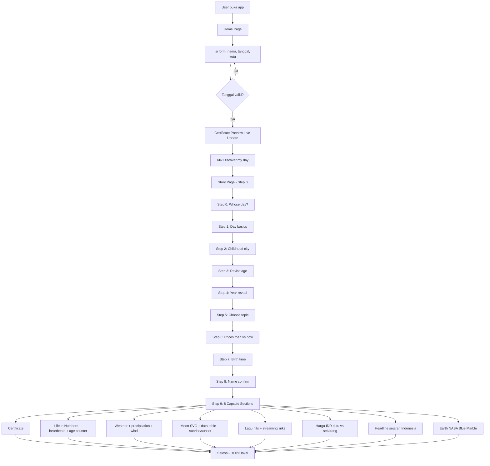

### Data Flow

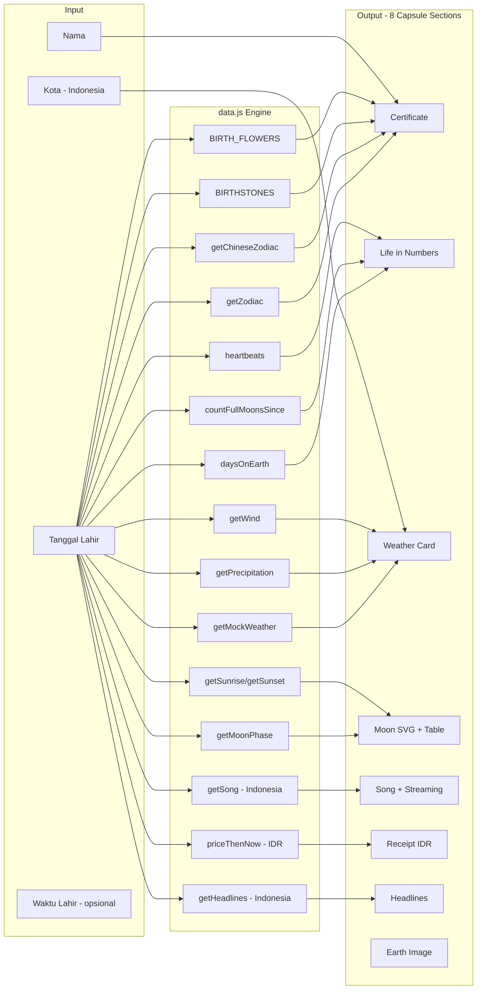

### Tech Stack

```
┌──────────────────────────────────────────────────────┐
│              TAM - BORNHERE APP                       │
├──────────────────────────────────────────────────────┤
│  Frontend:                                           │
│  ├── HTML5 (semantic, 839 baris)                     │
│  ├── CSS3 (custom design system, 1489 baris)         │
│  │   ├── Dark gold theme (#15110d / #e3ad4b)        │
│  │   ├── 8 capsule section styles                    │
│  │   ├── Mobile responsive (max-width: 640px)        │
│  │   └── Safe-area padding                           │
│  └── Vanilla JavaScript (no framework, 301+ baris)   │
│      ├── Moon phase calculator (astronomical)        │
│      ├── Zodiac + Chinese zodiac                     │
│      ├── Live age counter (setInterval)              │
│      ├── SVG moon renderer                           │
│      └── Starfield canvas animation                  │
├──────────────────────────────────────────────────────┤
│  Fonts:                                              │
│  ├── Cormorant Garamond (serif - headlines)          │
│  ├── DM Sans (sans-serif - body)                     │
│  └── JetBrains Mono (monospace - labels)             │
├──────────────────────────────────────────────────────┤
│  Server & Deploy:                                    │
│  ├── Node.js HTTP server (local dev, 25 baris)       │
│  ├── Vercel (production, auto-deploy dari GitHub)    │
│  └── Cache-busting (?v=3) untuk data.js & styles.css │
├──────────────────────────────────────────────────────┤
│  Testing:                                            │
│  └── Custom unit test runner (57 test cases)         │
├──────────────────────────────────────────────────────┤
│  Privacy:                                            │
│  ├── 0 external API calls                            │
│  ├── 0 tracking / analytics                          │
│  ├── 0 database                                      │
│  └── 100% client-side computation                    │
└──────────────────────────────────────────────────────┘
```

---

## 🎨 Design System

### Color Palette

| Variable | Value | Usage |
|----------|-------|-------|
| `--background` | `#15110d` | Background utama |
| `--foreground` | `#f2eadd` | Text utama |
| `--surface` | `#1d1713` | Card background |
| `--surface-2` | `#231d18` | Card alternatif |
| `--ink-soft` | `#aea394` | Subtext |
| `--gold` | `#e3ad4b` | Accent utama |
| `--gold-soft` | `rgba(227,173,75,0.13)` | Hover bg |
| `--border` | `rgba(255,255,255,0.08)` | Borders |
| `--destructive` | `#de3b3d` | Error |

### Typography
- **Display**: `Cormorant Garamond` — italic, 400-600 weight, buat headline dan certificate
- **Body**: `DM Sans` — 300-500 weight, buat paragraph dan form
- **Mono**: `JetBrains Mono` — uppercase + letter-spacing buat label dan meta

### Visual Effects
- **Starfield**: Canvas-based animated star background dengan twinkle effect
- **Vignette**: Radial gradient overlay buat efek "night sky"
- **Grain**: Subtle noise texture overlay
- **Gold glow**: `box-shadow: 0 0 80px rgba(227,173,75,0.22)`
- **Moon glow**: `filter: drop-shadow(0 0 28px rgba(244,228,188,0.28))`
- **Fade transitions**: Smooth step transitions
- **Ping animation**: Pulse effect di notification dot

---

## 📸 Screenshots

### Halaman Utama

**Hero Section** — headline, counter, date display:
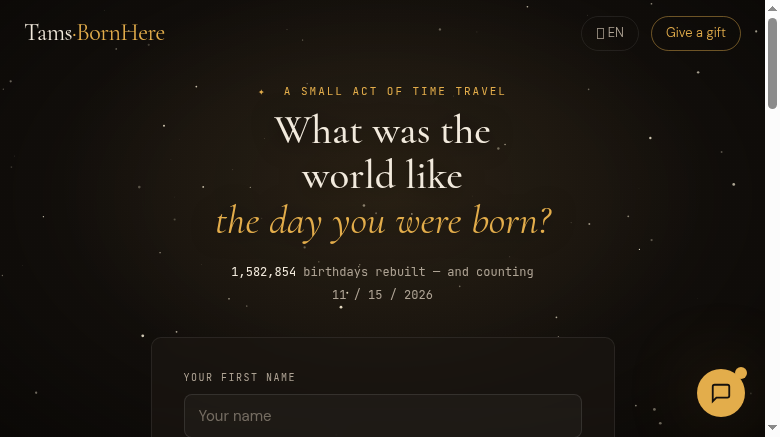

**Form Input** — nama, tanggal lahir, kota Indonesia:


**Certificate Preview** — live update saat user ngetik:
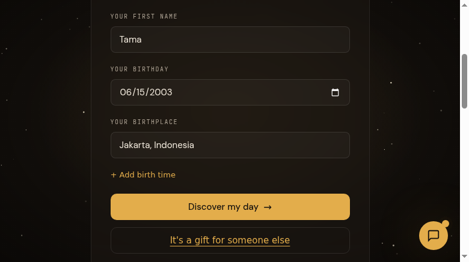

**Explore Section** — 3 contoh sejarah Indonesia:
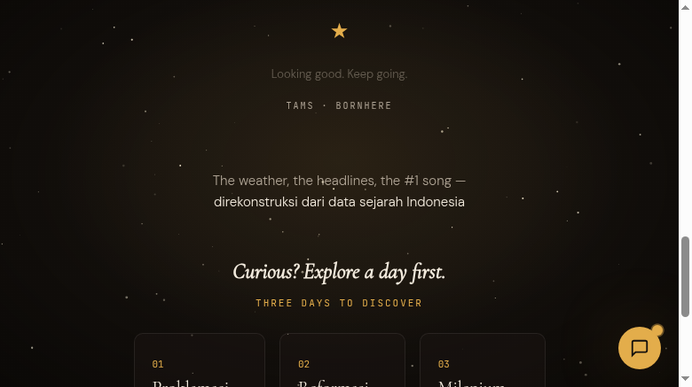

### Halaman Story

**Step 0** — "Whose day are we bringing back?":


**Step 1** — Day basics: day of week, days on earth, full moons:


**Step 6** — Shopping basket dengan harga IDR then vs now:
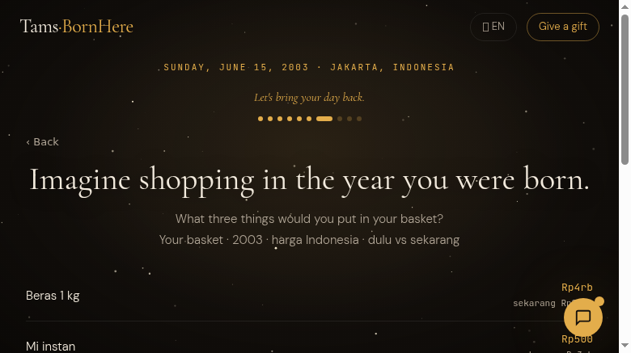

### Final Step — 8 Capsule Sections

**Certificate of Arrival**:
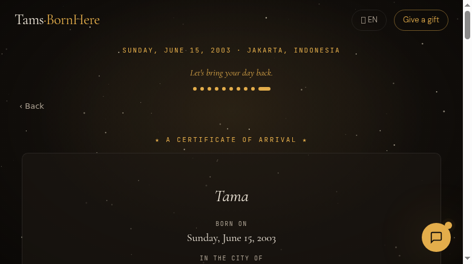

**Your Life · In Numbers** — heartbeats, days alive, full moons, live age counter:
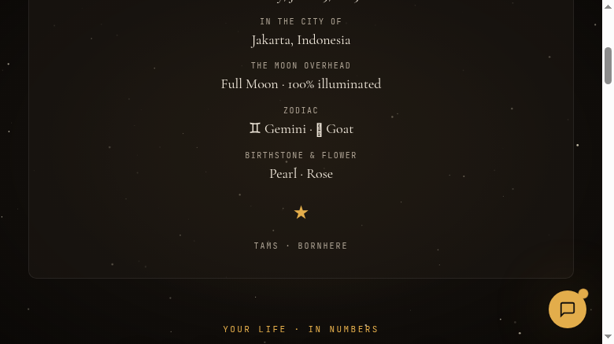

**The Air Around You + The Sky Above You** — weather card + moon SVG + data table:
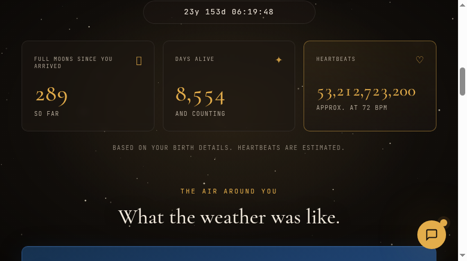

**The Soundtrack + The Receipt** — lagu hits + streaming links + harga IDR:
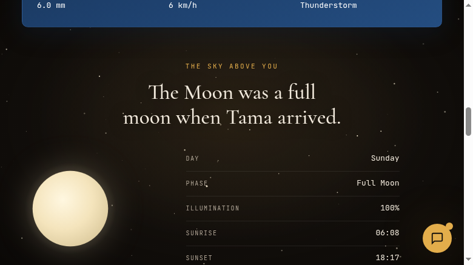

**The Headlines + Earth** — sejarah Indonesia + NASA Blue Marble:
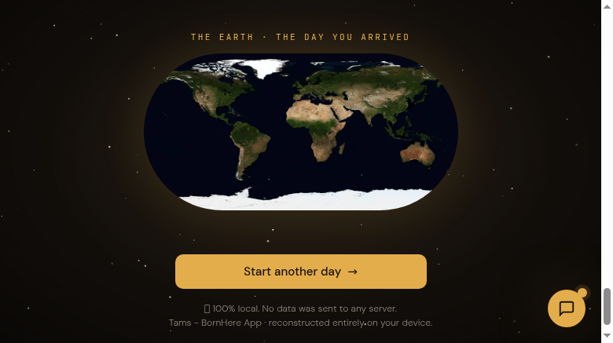

---

## 🚀 Cara Jalanin

### Prasyarat
- [Node.js](https://nodejs.org/) v18+ (atau yang lebih baru)
- Browser modern (Chrome, Firefox, Safari, Edge)

### Install & Run

```bash
# Clone repo
git clone https://github.com/el-pablos/tams-bornhere-app.git
cd tams-bornhere-app

# Jalanin server
node server.js

# Buka di browser
# http://localhost:8080
```

### Run Tests

```bash
node test.js
```

Output:
```
========================================
  UNIT TEST RESULTS — Tams BornHere App
========================================

✅ Moon: Apollo 11 has valid phase name
✅ Zodiac: Jan 20 = Aquarius
✅ Zodiac: Jun 15 = Gemini
✅ Chinese: 2003 = Goat
✅ Chinese: 1969 = Rooster
✅ Story: has heartbeats > 1B
✅ Story: has sunrise format
✅ Story: 1970 song = Lilin-Lilin Kecil
✅ Story: 2000 song = Teman Tapi Mesra
✅ Prices: 1970 beras < 1000
... (57 tests total)

  Total: 57 | Passed: 57 | Failed: 0
  Status: ✅ ALL PASSED
```

### Deploy ke Vercel (auto-deploy dari GitHub)

Repo ini udah terhubung ke Vercel — tiap push ke `main` auto-deploy ke production:

```
git push origin main
→ Vercel detect push
→ Build & deploy otomatis
→ Production URL auto-update
```

Live URL: https://tams-bornhere-app.vercel.app

---

## 🔒 Privacy & Security

```
┌──────────────────────────────────────────────────┐
│              PRIVACY GUARANTEES                   │
├──────────────────────────────────────────────────┤
│                                                   │
│  ❌ No external API calls                         │
│  ❌ No tracking / analytics                       │
│  ❌ No database                                   │
│  ❌ No cookies                                    │
│  ❌ No data sent to any server                    │
│  ❌ No account needed                             │
│                                                   │
│  ✅ 100% client-side computation                 │
│  ✅ All data stays in browser                     │
│  ✅ Works offline (after fonts cache)            │
│  ✅ No third-party scripts                        │
│  ✅ .gitignore prevents secret leakage            │
│  ✅ Cache-busting (?v=3) untuk update terkini    │
│                                                   │
└──────────────────────────────────────────────────┘
```

---

## 🧪 Testing

Unit test mencakup semua modul perhitungan:

| Modul | Test Count | Coverage |
|-------|-----------|----------|
| Moon Phase | 5 | Phase name, emoji, illumination, reference date |
| Zodiac (Western) | 13 | Semua 12 zodiak + symbol |
| Chinese Zodiac | 6 | 5 tahun sample + symbol |
| Story Data Assembly | 20 | Name, year, dayOfWeek, days, fullMoons, moon, zodiac, chinese, birthstone, flower, prices, song, weather, headlines, heartbeats, sunrise, sunset, precipitation, wind |
| Song Database | 2 | 1970 + 2000 verification |
| Prices (IDR) | 2 | 1970 beras + bensin |
| Weather Determinism | 2 | Same date = same temp + condition |
| Edge Cases | 3 | Leap year, early date, Nov 9 1989 |
| **Total** | **57** | **All passing ✅** |

---

## 📊 Data Sources & Accuracy

### Astronomical Calculations
- **Moon phase**: Synodic month 29.53059 hari, reference new moon Jan 6, 2000 18:14 UTC
- **Full moons count**: Hitung dari siklus synodic month
- **Sunrise/Sunset**: Estimasi untuk region equatorial (Indonesia ~5:38/17:47)

### Data Indonesia
- **Lagu hits**: Chart radio Prambors, kompilasi musik Indonesia per dekade (1970-2025)
  - 1970s: Chrisye, Koes Plus
  - 1980s: Fariz RM, Nicky Astria
  - 1990s: Iwan Fals, Nike Ardilla
  - 2000s: Ratu, Bondan Prakoso
  - 2010s: Adera, Cherrybelle
  - 2020s: Tulus
- **Harga IDR**: BPS, Bank Indonesia, data inflasi per dekade
  - 1970: beras Rp250/kg, motor Rp145.000
  - 2000: beras Rp3.500/kg, motor Rp8.000.000
  - 2025: beras Rp25.000/kg, motor Rp18.000.000
- **Headline**: Wikipedia garis waktu sejarah Indonesia, metrotvnews.com
  - 1945: Proklamasi Kemerdekaan
  - 1965: G30S dan awal Orde Baru
  - 1998: Reformasi, Soeharto mundur
  - 2004: Tsunami Aceh
  - 2020: Pandemi COVID-19

### Weather
Weather di-generate berdasarkan musim dan tanggal. **Deterministik** — tanggal yang sama selalu menghasilkan cuaca yang sama. Estimasi, bukan data historis asli.

---

## 📈 Repo Statistics

```
┌─────────────────────────────────────────────┐
│            REPO STATS                        │
├─────────────────────────────────────────────┤
│  Commits:          25                        │
│  Source files:     8                         │
│  Test cases:       57 (all passing)          │
│  Screenshots:      12                        │
│  CSS lines:        1489                      │
│  JS lines:         301 (data) + 839 (ui)     │
│  HTML lines:       839                       │
│  Capsule sections: 8                         │
│  Story steps:      10                        │
│  External APIs:    0                         │
│  Dependencies:     0 (zero npm deps)         │
│  Languages:        HTML, CSS, JavaScript     │
│  Deploy:           Vercel (auto-deploy)      │
│  Cache-busting:    ?v=3                      │
└─────────────────────────────────────────────┘
```

---

## 🛠️ Customization

### Ganti Warna
Edit `:root` di `styles.css`:
```css
:root {
  --background: #15110d;
  --gold: #e3ad4b;
  --foreground: #f2eadd;
}
```

### Tambah Lagu Indonesia Baru
Edit `SONGS` di `data.js`:
```javascript
const SONGS = {
  2024: { title: "Lagu Baru", artist: "Artis Indonesia" },
};
```

### Tambah Harga IDR Baru
Edit `PRICE_DATA` di `data.js`:
```javascript
const PRICE_DATA = {
  2024: { rice: 20000, noodle: 2800, gas: 7000, ... },
};
```

### Tambah Headline Sejarah
Edit `HEADLINES` di `data.js`:
```javascript
const HEADLINES = {
  2024: ["Headline baru di Indonesia", "Event bersejarah lainnya"],
};
```

---

## 🤝 Contributing

Mau kontribusi? Open issue atau pull request. Beberapa ide pengembangan:

- [ ] Printable certificate export (PDF)
- [ ] Lebih banyak kota Indonesia
- [ ] Data cuaca historis asli (perlu API berbayar)
- [ ] Lebih detail harga per tahun (bukan per dekade)
- [ ] Share certificate as image
- [ ] PWA support (offline-first)
- [ ] Multi bahasa (Indonesia + English toggle)
- [ ] Cosmic zoom intro animation

---

## 📝 License

MIT License — bebas pakai, modify, dan distribute.

---

<div align="center">

**Tams - BornHere App** — *Made for the day you arrived* 🌙

Dibuat dengan ❤️ di Indonesia · 100% lokal, tanpa tracking, tanpa drama.

🌐 https://tams-bornhere-app.vercel.app

</div>
