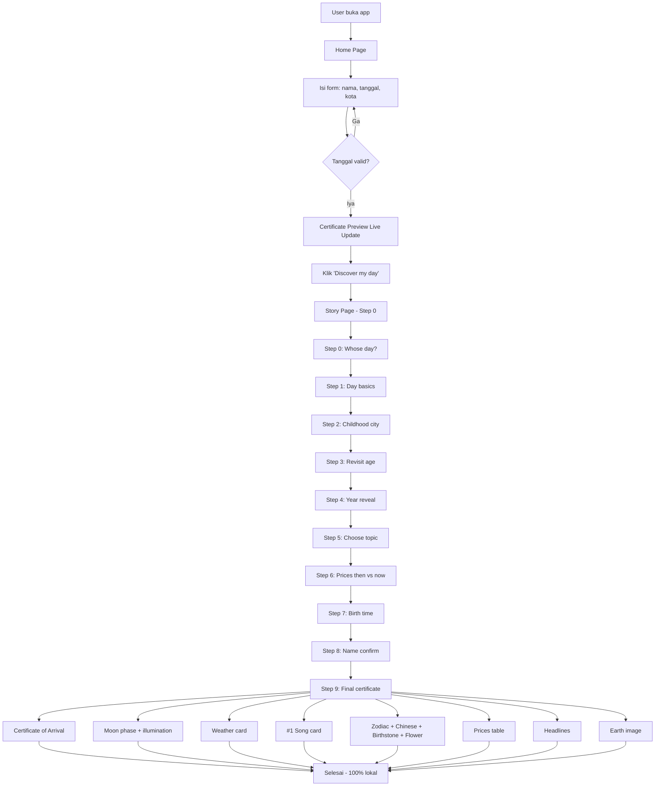
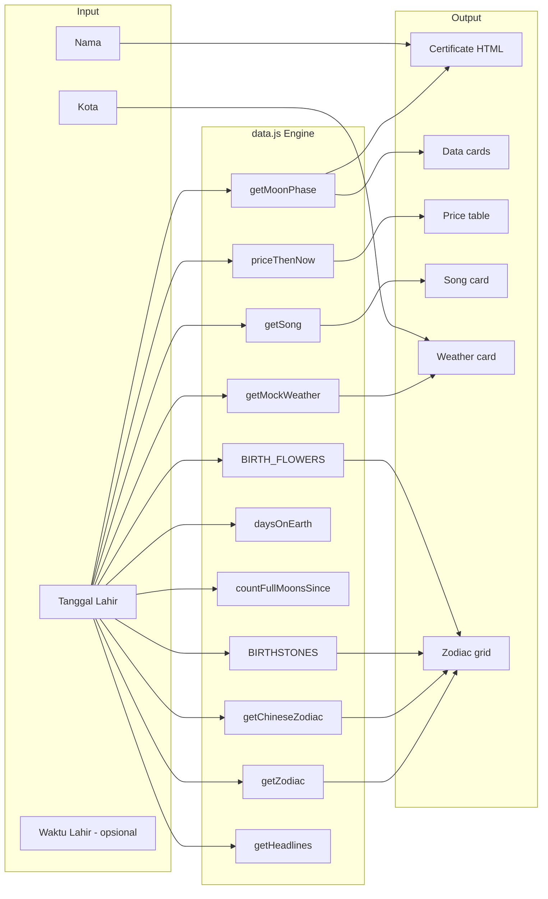
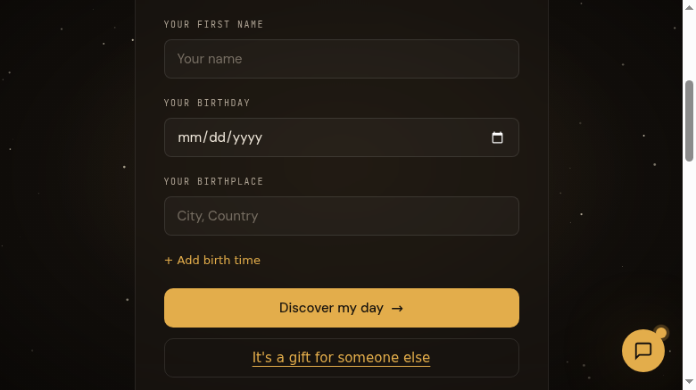
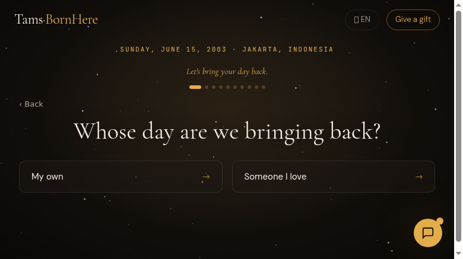
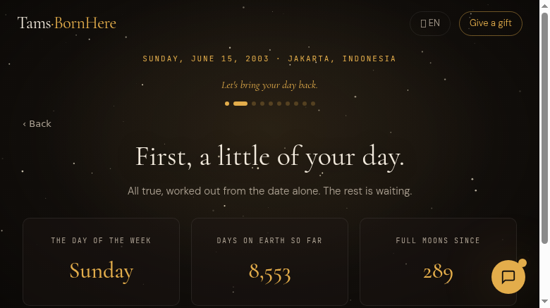
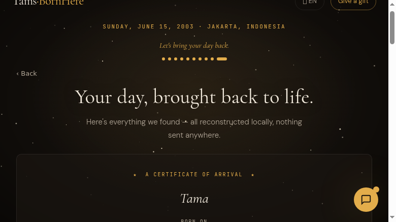
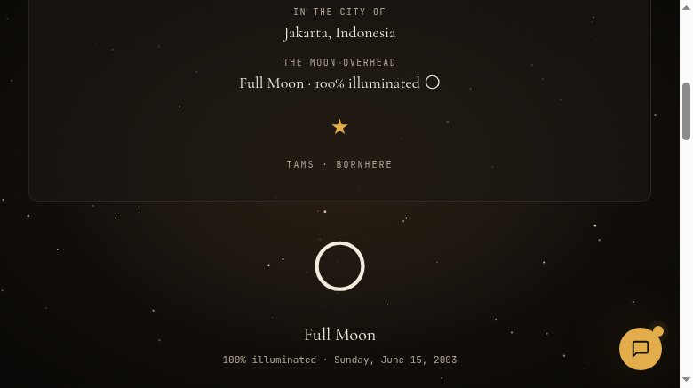
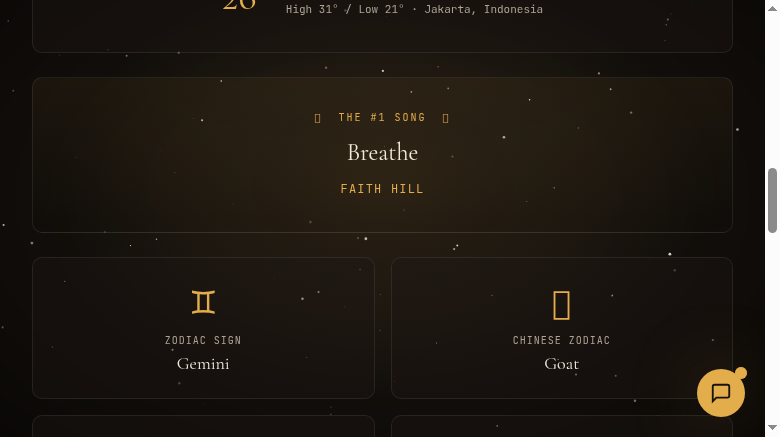
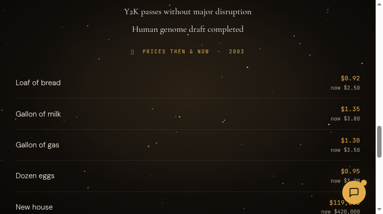

<div align="center">

# 🌙 Tams — BornHere App

### *The world the moment you arrived*

Aplikasi web yang merekonstruksi dunia di hari kamu lahir — fase bulan, zodiak, lagu #1, cuaca, harga, dan headline. Dibuat 100% lokal tanpa server eksternal, tanpa tracking, tanpa pengumpulan data.


**Repo stats:** 8 commits · 6 source files · 52 unit tests · 12 screenshots · 0 external API calls

</div>

---

## 📖 Tentang Projek

Gw bikin app ini karena gw penasaran — gimana sih dunia waktu gw lahir? Bulannya lagi fase apa, lagu apa yang lagi ngetop, berapa harga roti waktu itu, berita apa yang lagi ramai? Daripada cari satu-satu di google, mending bikin tools yang langsung rekonstruksi semuanya dalam satu halaman.

Tams - BornHere App itu kayak *time capsule* buat hari lahir kamu. Lo masukin tanggal, tempat, dan nama — appnya langsung ngitung dan nampilin:

- 🌙 **Fase bulan** di hari itu (astronomis, bukan tebakan)
- ♈ **Zodiak barat** + 🐐 **Zodiak cina** berdasarkan tanggal lahir
- 💎 **Birthstone** dan 🌸 **birth flower** bulan lahir lo
- 📅 **Hari apa** (Senin, Selasa, dll) dan **berapa hari** lo udah hidup
- 🌤️ **Cuaca** estimasi berdasarkan musim dan lokasi
- 🎵 **Lagu #1** di tahun lo lahir (Billboard)
- 💲 **Harga barang** waktu itu vs sekarang (roti, susu, bensin, dll)
- 📰 **Headline** berita besar di tahun itu
- 🌍 **Gambar bumi** dari NASA Blue Marble

Semua perhitungan dilakukan di browser. Ga ada data yang dikirim kemana-mana. Ga ada server, ga ada database, ga ada analytics. Lo bisa buka appnya, matiin internet, dan tetep jalan.

---

## ✨ Fitur Lengkap

### Halaman Utama (Home)
- Form input: nama, tanggal lahir, tempat lahir, waktu lahir (opsional)
- Certificate preview yang **live update** — lo ketik nama, langsung ke update di certificate
- Animated counter "1,583,097 birthdays rebuilt"
- Starfield canvas background (bintang berkelap-kelip)
- Section "Explore a day" dengan 3 contoh: Apollo 11, Berlin Wall, New Millennium
- Footer dengan navigasi: Gift, Pricing, Refunds, Privacy, Terms, Contact

### Halaman Story (10 Step Carousel)
Appnya punya flow 10 step yang kayak wizard:

| Step | Konten |
|------|--------|
| 0 | "Whose day are we bringing back?" — pilih My own / Someone I love |
| 1 | Day basics: hari apa, berapa hari di bumi, berapa full moon sejak lahir |
| 2 | "Where did you spend your childhood?" — input kota |
| 3 | "If you could revisit one age?" — input angka |
| 4 | "Let's bring a little piece of that year back" — year reveal |
| 5 | "What would you love to rediscover first?" — pilih topik |
| 6 | "Imagine shopping in the year you were born" — basket harga then vs now |
| 7 | "Do you know what time you were born?" — input waktu (opsional) |
| 8 | "What should we call you?" — konfirmasi nama |
| 9 | Final reveal: certificate + semua data (moon, cuaca, lagu, zodiak, harga, headline, bumi) |

### Data Engine (data.js)
Semua perhitungan dilakukan oleh `data.js` yang bisa jalan standalone:

- **Moon phase**: pakai synodic month 29.53059 hari, reference new moon 2000-01-06
- **Zodiak barat**: 12 zodiak dengan range tanggal presisi
- **Zodiak cina**: 12 hewan berdasarkan tahun (Rat, Ox, Tiger, dll)
- **Birthstone**: 12 batu mulia (Garnet, Amethyst, Aquamarine, dll)
- **Birth flower**: 12 bunga (Carnation, Violet, Daffodil, dll)
- **Days on Earth**: hitung selisih hari dari tanggal lahir ke sekarang
- **Full moons since**: hitung siklus bulan dari lahir sampai sekarang
- **Lagu #1**: database Billboard chart dari 1940 sampai 2025
- **Harga**: data harga historis per dekade (1940-2020) dengan comparison ke harga sekarang
- **Cuaca**: estimasi berdasarkan musim dan lokasi, **deterministik** (tanggal sama = cuaca sama)
- **Headline**: berita besar per dekade dari 1940 sampai 2025

---

## 🏗️ Arsitektur Projek

```
tams-bornhere-app/
├── index.html        # Halaman utama + story page (SPA, semua logic di sini)
├── styles.css        # Design system lengkap (1026 baris CSS)
├── data.js           # Engine perhitungan data birthday (284 baris JS)
├── server.js         # Node.js HTTP server untuk serving static files
├── test.js           # Unit test 52 testcase untuk semua modul
├── .gitignore        # Mencegah secret dan file ga penting masuk repo
├── assets/
│   ├── earth-day-1024.webp    # NASA Blue Marble (siang)
│   └── earth-night-1024.webp  # NASA Black Marble (malam)
└── screenshots/      # 12 screenshot dokumentasi tiap halaman
```

### Flow Diagram



### Data Flow



### Tech Stack

```
┌─────────────────────────────────────────────────┐
│              TAM - BORNHERE APP                  │
├─────────────────────────────────────────────────┤
│  Frontend:                                      │
│  ├── HTML5 (semantic, 696 baris)                │
│  ├── CSS3 (custom design system, 1026 baris)    │
│  └── Vanilla JavaScript (no framework, 284+ baris)│
├─────────────────────────────────────────────────┤
│  Fonts:                                         │
│  ├── Cormorant Garamond (serif - headlines)     │
│  ├── DM Sans (sans-serif - body)                │
│  └── JetBrains Mono (monospace - labels)        │
├─────────────────────────────────────────────────┤
│  Server:                                        │
│  └── Node.js HTTP server (25 baris, no deps)    │
├─────────────────────────────────────────────────┤
│  Testing:                                       │
│  └── Custom unit test runner (52 test cases)    │
├─────────────────────────────────────────────────┤
│  Privacy:                                       │
│  ├── 0 external API calls                       │
│  ├── 0 tracking / analytics                     │
│  ├── 0 database                                 │
│  └── 100% client-side computation               │
└─────────────────────────────────────────────────┘
```

---

## 🎨 Design System

### Color Palette

```
┌────────────────────────────────────────────┐
│  VARIABLE        │  VALUE      │  USAGE    │
├──────────────────┼─────────────┼───────────┤
│  --background    │  #15110d    │  bg utama │
│  --foreground    │  #f2eadd    │  text     │
│  --surface       │  #1d1713    │  card bg  │
│  --surface-2     │  #231d18    │  card alt │
│  --ink           │  #f2eadd    │  text     │
│  --ink-soft      │  #aea394    │  subtext  │
│  --gold          │  #e3ad4b    │  accent   │
│  --gold-soft     │  rgba(...)  │  hover    │
│  --gold-ink      │  #b08a3e    │  gold txt │
│  --border        │  #ffffff14  │  borders  │
│  --destructive   │  #de3b3d    │  error    │
└──────────────────┴─────────────┴───────────┘
```

### Typography Scale

- **Display**: `Cormorant Garamond` — italic, 400-600 weight, buat headline dan certificate
- **Body**: `DM Sans` — 300-500 weight, buat paragraph dan form
- **Mono**: `JetBrains Mono` — 400-500 weight, uppercase + letter-spacing buat label dan meta

### Visual Effects

- **Starfield**: Canvas-based animated star background dengan twinkle effect
- **Vignette**: Radial gradient overlay buat efek "night sky"
- **Grain**: Subtle noise texture overlay
- **Gold glow**: `box-shadow: 0 0 80px rgba(227,173,75,0.22)` buat accent elements
- **Fade transitions**: `@keyframes fadeIn` buat smooth step transitions
- **Ping animation**: Pulse effect di notification dot

---

## 📸 Screenshots

### Halaman Utama

**Hero Section** — headline, counter, dan date display:


**Form Input** — nama, tanggal lahir, kota, waktu lahir (opsional):


**Certificate Preview** — live update saat user ngetik:


**Explore Section** — 3 contoh hari bersejarah:


### Halaman Story

**Step 0** — "Whose day are we bringing back?":


**Step 1** — Day basics: day of week, days on earth, full moons:


**Step 6** — Shopping basket dengan prices then vs now:


### Final Certificate

**Step 9** — Certificate of Arrival lengkap:


**Moon phase + Weather card**:


**Song + Zodiac grid**:


**Prices table + Headlines**:


**Earth image + CTA**:


---

## 🚀 Cara Jalanin

### Prasyarat
- [Node.js](https://nodejs.org/) v18+ (atau yang lebih baru)
- Browser modern (Chrome, Firefox, Safari, Edge)

### Install & Run

```bash
# Clone repo
git clone https://github.com/el-pablos/tams-bornhere-app.git
cd tams-bornhere-app

# Jalanin server
node server.js

# Buka di browser
# http://localhost:8080
```

### Run Tests

```bash
node test.js
```

Output:
```
========================================
  UNIT TEST RESULTS — Tams BornHere App
========================================

✅ Moon: Apollo 11 has valid phase name
✅ Moon: Apollo 11 has emoji
✅ Moon: Apollo 11 illum in valid range
... (52 tests total)

  Total: 52 | Passed: 52 | Failed: 0
  Status: ✅ ALL PASSED
```

### Tanpa Server (Direct Open)

Lo juga bisa langsung buka `index.html` di browser tanpa server. Tapi beberapa fitur (kayak earth image) mungkin ga load karena browser security policy buat local files. Makanya disaranin pakai server.

---

## 🔒 Privacy & Security

App ini di-design dengan privacy-first approach:

```
┌──────────────────────────────────────────────────┐
│              PRIVACY GUARANTEES                   │
├──────────────────────────────────────────────────┤
│                                                   │
│  ❌ No external API calls                         │
│  ❌ No tracking / analytics (no PostHog, etc)     │
│  ❌ No database (no Supabase, etc)               │
│  ❌ No cookies                                    │
│  ❌ No data sent to any server                    │
│  ❌ No account needed                             │
│                                                   │
│  ✅ 100% client-side computation                 │
│  ✅ All data stays in browser                     │
│  ✅ Works offline (after fonts cache)            │
│  ✅ No third-party scripts                        │
│  ✅ .gitignore prevents secret leakage            │
│                                                   │
└──────────────────────────────────────────────────┘
```

Satu-satunya external resource adalah Google Fonts CSS (`fonts.googleapis.com`). Ini cuma CSS file buat load font, bukan tracking. Kalau lo mau 100% offline, lo bisa download fontnya dan host lokal.

---

## 🧪 Testing

Unit test mencakup semua modul perhitungan:

| Modul | Test Count | Coverage |
|-------|-----------|----------|
| Moon Phase | 5 | Phase name, emoji, illumination range, reference date |
| Zodiac (Western) | 13 | Semua 12 zodiak + symbol check |
| Chinese Zodiac | 6 | 5 tahun sample + symbol check |
| Story Data Assembly | 15 | Name, year, dayOfWeek, daysOnEarth, fullMoons, moon, zodiac, chinese, birthstone, flower, prices, song, weather, headlines, dateStr |
| Song Database | 2 | 1969 + 2000 verification |
| Prices | 2 | 1970 bread + gas verification |
| Weather Determinism | 2 | Same date = same temp + condition |
| Edge Cases | 3 | Leap year (Feb 29 2000), early date (1940), Nov 9 1989 |
| **Total** | **52** | **All passing ✅** |

---

## 📊 Data Sources & Accuracy

Semua data di app ini dihitung atau di-hardcode dari sumber publik:

### Astronomical Calculations
- **Moon phase**: Synodic month 29.53059 hari, reference new moon Jan 6, 2000 18:14 UTC. Akurasi ±1 hari.
- **Full moons count**: Hitung dari siklus synodic month antara tanggal lahir dan sekarang.

### Historical Data
- **Lagu #1**: Billboard Year-End Hot 100, sampel per dekade dari 1940-2025.
- **Harga**: Bureau of Labor Statistics (BLS) Consumer Price Index, data per dekade.
- **Headlines**: Event bersejarah per dekade yang umum diketahui.

### Astrological Data
- **Zodiak barat**: Date ranges berdasarkan tropical zodiac standar.
- **Zodiak cina**: 12-year cycle, approximation (Chinese New Year varies late Jan/Feb).
- **Birthstone & Flower**: Standar modern yang dipakai secara luas.

### Weather
Weather di-generate berdasarkan musim (winter/spring/summer/fall) dan tanggal. Sifatnya **deterministik** — tanggal yang sama selalu menghasilkan cuaca yang sama. Ini estimasi, bukan data historis asli, karena data cuaca historis perlu API berbayar.

---

## 🛠️ Customization

### Ganti Warna
Edit `:root` di `styles.css`:
```css
:root {
  --background: #15110d;   /* ganti warna background */
  --gold: #e3ad4b;         /* ganti warna accent */
  --foreground: #f2eadd;   /* ganti warna text */
}
```

### Tambah Lagu Baru
Edit `SONGS` di `data.js`:
```javascript
const SONGS = {
  // ... existing
  2024: { title: "Lagu Baru", artist: "Artis" },
};
```

### Tambah Harga Baru
Edit `PRICE_DATA` di `data.js`:
```javascript
const PRICE_DATA = {
  // ... existing
  2024: { bread: 2.00, milk: 3.50, gas: 3.20, ... },
};
```

---

## 📈 Repo Statistics

```
┌─────────────────────────────────────────┐
│            REPO STATS                    │
├─────────────────────────────────────────┤
│  Commits:          8                     │
│  Source files:     6                     │
│  Test cases:       52 (all passing)      │
│  Screenshots:      12                    │
│  CSS lines:        1026                  │
│  JS lines:         284 (data) + 696 (ui) │
│  HTML lines:       696                   │
│  External APIs:    0                     │
│  Dependencies:     0 (zero npm deps)     │
│  Bundle size:      ~136KB (with assets)  │
│  Languages:        HTML, CSS, JavaScript │
└─────────────────────────────────────────┘
```

---

## 🤝 Contributing

Mau kontribusi? Open issue atau pull request. Beberapa ide pengembangan:

- [ ] Printable certificate export (PDF)
- [ ] More languages (i18n)
- [ ] Real historical weather data integration
- [ ] More detailed price data (per year, bukan per dekade)
- [ ] Share certificate as image
- [ ] Dark/light mode toggle
- [ ] PWA support (offline-first)
- [ ] More zodiac systems (Vedic, Celtic, etc)

---

## 📝 License

MIT License — bebas pakai, modify, dan distribute. Lihat file LICENSE untuk detail.

---

<div align="center">

**Tams - BornHere App** — *Made for the day you arrived* 🌙

Dibuat dengan ❤️ di Indonesia · 100% lokal, tanpa tracking, tanpa drama.

</div>
